  

  

  

    
    
    
  

---

## 👋 About Me

I'm **Ganesh Tupe**, a Computer Engineering student at **Smt. Kashibai Navale College of Engineering, Pune**, working toward my goal of becoming a **Java Developer**.

- 🎓 B.E. Computer Engineering student
- ☕ Learning Java and strengthening object-oriented programming fundamentals
- 🧠 Practicing Data Structures and Algorithms (DSA)
- 🛠️ Building projects to develop practical software engineering skills
- 🗃️ Learning and practicing SQL
- 🤖 Exploring Python and machine learning concepts
- 🎯 Preparing for software engineering placements

## 🏆 Achievement

- 🥇 **Academic Excellence Award — First Year**

## 🧰 Tech Stack & Learning

  
  
  
  
  

**Core concepts:** Object-Oriented Programming (OOP), Data Structures & Algorithms (DSA)  
**Currently exploring:** Machine Learning (ML)

## 🚀 Featured Projects

### 🛣️ RoadGuardian — Road Safety System

A Java-based road-safety application intended to help users access vehicle-related assistance and safety features.

- 🚘 Vehicle health and road-assistance features
- 🧑‍🔧 Mechanic assignment and location-based navigation
- 🆘 Emergency SOS functionality
- 💬 Chatbot-based vehicle diagnosis
- 🔥 Firebase Firestore for data storage and synchronization

**Technologies:** Core Java, JavaFX, Firebase Firestore

> The supplied RoadGuardian URL points to this profile README section, not a separate project repository. Add the actual RoadGuardian repository link when available.

### 🥗 SafeSense AI — AI-Powered Food & Consumer Product Safety Platform

A project focused on food and consumer product safety, with a modular Streamlit frontend and safety/complaint workflows being developed across project phases.

- Streamlit-based frontend
- Shared theme and reusable UI components
- Food-safety and complaint-related project workflows

**Technologies:** Python, Streamlit. Describe AI/ML and NLP as completed only when those components are implemented.

🔗 **Repository:** [SafeSense AI](https://github.com/ganeshtupe-18/SafeSenseAi)

## 📊 GitHub Statistics

  

  

   

  

These cards use third-party services and may occasionally be unavailable or rate-limited. Displayed data depends on public repositories and activity recognized by those services.

## 🐍 Contribution Graph

  <picture>
    <source media="(prefers-color-scheme: dark)" srcset="https://raw.githubusercontent.com/ganeshtupe-18/ganeshtupe-18/output/github-contribution-grid-snake-dark.svg"/>
    <source media="(prefers-color-scheme: light)" srcset="https://raw.githubusercontent.com/ganeshtupe-18/ganeshtupe-18/output/github-contribution-grid-snake.svg"/>
    
  </picture>

The contribution animation appears after the GitHub Actions workflow runs successfully and publishes the generated SVG to the output branch.

## 🎯 Current Goals

- [ ] Strengthen Java and OOP fundamentals
- [ ] Practice DSA consistently
- [ ] Improve problem-solving skills
- [ ] Build and improve practical projects
- [ ] Strengthen SQL and database knowledge
- [ ] Prepare for Java Developer / Software Engineer placements

## 🤝 Connect With Me

  
  
  

    
  

  <i>Learning, building, and growing one commit at a time. 💻</i>

